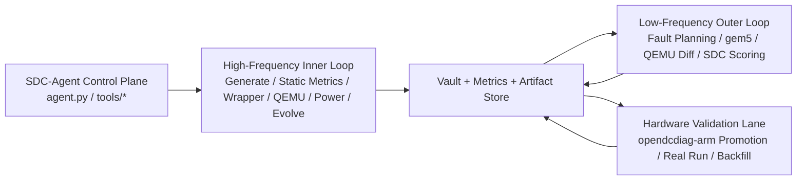
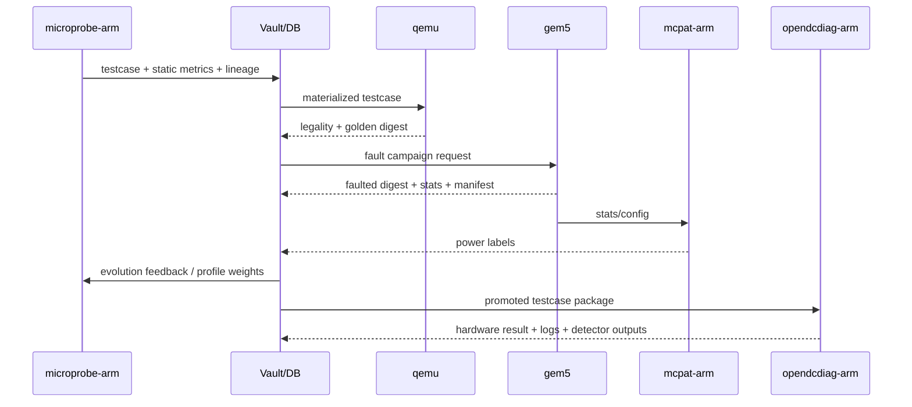

# SDC-Agent Specification

## 1. 规范目标

本规范定义 `SDC-Agent` 的完成态架构：把 `microprobe-arm`、`qemu`、`gem5`、`mcpat-arm`、`opendcdiag-arm` 组织成一套围绕 ARM64 指令流持续演进的 SDC 自动化发现系统。

当前仓库管理模型已经升级为单一 monorepo：

1. root 仓现在直接承载并追踪：
   - `microprobe/`
   - `qemu/`
   - `gem5/`
   - `mcpat/`
   - `opendcdiag/`
2. 这些核心子项目不再作为 root 之外的独立管理边界使用。
3. phase、状态、审阅与变更归属统一按 monorepo 内路径域管理，详见 [monorepo.md](/Users/wangxu/1-project/sdc-fuzzing/docs/monorepo.md)。

这里所说的“100% 实现 README 中的目标和愿景”，不是宣称当前仓库已经完成，而是要求：

1. 目标架构必须与现有源码事实一致。
2. 缺口必须被明确拆分为可落地的模块和阶段。
3. 最终形态必须同时闭环三层系统：
   - 高频内循环
   - 低频外循环
   - 硬件验证环

完成态判据如下：

1. `microprobe-arm` 可以按 profile 海量生成 ARM64 指令流并入库。
2. 每条样本都具有静态覆盖率、合法性、功耗、血缘和状态轨迹。
3. `qemu` 作为 golden executor 能稳定校验指令流可执行性与 golden digest。
4. `gem5` 能按 fault matrix 执行故障注入仿真，并为每次 fault run 留下可追溯记录。
5. `mcpat-arm` 能对外循环或内循环 shortlist 输出功耗标签并写回数据库。
6. `opendcdiag-arm` 能接收高价值样本、在真实硬件运行并把结果回灌数据库。

---

## 2. 基于源码的当前基线

下表只记录仓库里已经存在的真实实现，不把规划项混入“已完成”：

| 领域 | 当前实现锚点 | 真实现状 |
| --- | --- | --- |
| 控制平面 | `sdc_agent/agent.py`、`tools/sdc_agent.py` | 已提供 `status / generate / evolve / cycle` 骨架 |
| 生成 | `sdc_agent/generation.py`、`microprobe/targets/arm64/policies/sdc_fuzzing_policy.py` | 可生成 ARM64 指令流并写入 Vault |
| 静态分析 | `microprobe/src/microprobe/passes/sdc_analysis/offline_coverage.py` | 已有 ACE / IBR / Memory Pressure / Capstone pass |
| 入库 | `sdc_agent/vault.py` | 当前以 `offline_testcases` 单表为中心 |
| wrapper / 物料化 | `sdc_agent/materialize.py`、`microprobe/targets/arm64/wrappers/baremetaldiff.py` | 可把样本封装成 digest 风格可执行工件 |
| QEMU 校验 | `sdc_agent/differential.py` | 已把 `qemu-aarch64` 用作 golden executor |
| gem5 执行 | `gem5/configs/example/arm/sdc_kunpeng920_se.py` | 已有 SE runner，但 fault 注入仍是 manifest 记录 |
| 功耗 | `sdc_agent/power_analysis.py`、`sdc_agent/power_backends/mcpat_backend.py` | McPAT 主链可用，但未成为正式内循环步骤 |
| 调度与进化 | `sdc_agent/scheduler.py`、`microprobe/src/microprobe/driver/genetic.py` | 已有 ranking、fitness 与 Python 3 offspring 生成 |
| 硬件侧资产 | `opendcdiag/framework/device/cpu/arm64/arm64_sdc_detect.cpp`、`opendcdiag/tests/cpu/arm64/sdc_test.cpp` | ARM64 SDC 检测能力存在，但未接入主控制平面 |

### 2.1 子项目边界

1. `Sub-P1 microprobe-arm`
   - 当前是 monorepo 内生成与静态分析的真实来源。
2. `Sub-P2-1 qemu`
   - 当前是 monorepo 内 golden legality validator。
3. `Sub-P2-2 gem5`
   - 当前是 monorepo 内 fault-side simulator 和 stats producer；真实 injector 尚未落地。
4. `Sub-P3 mcpat-arm`
   - 当前在 monorepo 内通过 `pypat` 与 gem5 输出对接。
5. `Sub-P0 opendcdiag-arm`
   - 当前在 monorepo 内拥有 ARM64 SDC 检测资产，但还未承担完整 promotion/backfill 流程。

---

## 3. 核心能力（Core Skills）

本项目的“核心 skill”应理解为系统级核心能力，而不是单一脚本：

| Core Skill | 输入 | 当前实现 | 完成态升级方向 |
| --- | --- | --- | --- |
| ISA-aware generation | target、policy、seed、profile | `sdc_agent/generation.py` | profile-aware、template-aware、LLM-aware 生成 |
| Static coverage scoring | 指令流 | `offline_coverage.py` | 覆盖率版本化、更多微架构启发式 |
| Corpus persistence | testcase、metrics、status | `sdc_agent/vault.py` | 多表模型、artifact/run/history 分层 |
| Materialization | asm / wrapper metadata | `sdc_agent/materialize.py` | profile-specific wrapper、硬件版 emitter |
| Golden legality validation | materialized ELF | `sdc_agent/differential.py` + qemu | 批处理、缓存、非法指令分类 |
| Fault differential execution | same testcase + fault request | `campaign.py` + gem5 runner | 真正的 fault matrix + injector |
| Power labeling | gem5 stats / config | `mcpat_backend.py` | 批量标注、inner loop 标配 |
| Evolution guidance | lineage + score + power | `scheduler.py` + `genetic.py` | profile reweighting、LLM/PCFG/template 协同 |
| Hardware promotion & backfill | promoted testcase | `opendcdiag` 资产 + placeholder backend | 自动生成测试、真机执行、结果回灌 |

---

## 4. 总体架构



### 4.1 架构规则

1. `qemu` 只负责 golden side，不承担 fault 语义。
2. `gem5` 负责 fault-side 与微架构统计，不承担真实硬件结论。
3. `opendcdiag-arm` 只属于最终硬件验证环，不进入高频仿真路径。
4. 数据库是总线；模块之间不能靠临时文件命名规则长期耦合。
5. 高频内循环追求吞吐，低频外循环追求精度，硬件验证环追求最终置信度。

---

## 5. 高频内循环

## 5.1 目标

高频内循环的目标不是“找到最终答案”，而是用尽可能低的成本把海量候选压缩成一批值得进入 fault campaign 的 `INNER_READY` 种子。

## 5.2 内循环阶段

| Stage | 动作 | 当前实现锚点 | 完成态数据库写入 |
| --- | --- | --- | --- |
| 1. Generate | 调用 `microprobe-arm` 生成指令流 | `sdc_agent/generation.py`、`mp_sdc_offline_gen.py` | `testcases`、`lineage_events` |
| 2. Static Coverage | 计算 ACE / IBR / Memory Pressure / Capstone | `offline_coverage.py` | `static_metrics` |
| 3. Persist | 以 testcase_key 为主键入库 | `sdc_agent/vault.py` | `testcases` 状态 `STATIC_DONE` |
| 4. Materialize | 封装 digest wrapper，生成 C/ELF | `sdc_agent/materialize.py` | `artifacts`、`inner_runs` |
| 5. QEMU Validate | 用 `qemu-aarch64` 验证合法性并取 golden digest | `sdc_agent/differential.py` | `inner_runs`、`qemu_golden_hash` |
| 6. Power Annotate | 对 shortlist 做 gem5 bare-metal + McPAT，写入功耗 | `power_analysis.py`、`mcpat_backend.py` | `power_annotations` |
| 7. Evolve | 根据覆盖率、合法性、功耗反馈指导下一代生成 | `scheduler.py`、`genetic.py` | `lineage_events`、权重调整记录 |

## 5.3 内循环输入输出

输入：

1. generation profile
2. seed 或 parent lineage
3. target / policy / wrapper contract

输出：

1. `STATIC_DONE` 样本
2. `GOLDEN_READY` 样本
3. `POWER_READY` 样本
4. `INNER_READY` 样本
5. 下一代 offspring

## 5.4 profile 设计

内循环必须显式支持两个 profile：

1. `SIM_SAFE`
   - 面向 qemu/gem5 稳定运行的指令子集
   - 当前 `SDCSensitiveAnalyzer` 实际上已经在走这条路径
2. `HW_AGGRESSIVE`
   - 面向真实硬件探索的激进指令族
   - 包括 README 提到的 NEON FMA、LDP/STP、LSE、缓存冲击模式
   - 当前仍是规划项

设计原因很直接：

1. README 目标要求更激进的指令覆盖。
2. 当前生成策略为了兼容 gem5/qemu，默认排除了大量高价值指令。
3. 如果没有双 profile，评分器会偏好某些模式，但生成器永远难以产出它们。

## 5.5 内循环评分

内循环至少要维护两种分数：

1. `static_risk_score`
   - 来源：ACE / IBR / Memory Pressure / Capstone
   - 作用：决定海量样本的初始筛选优先级
2. `inner_value_score`
   - 来源：`static_risk_score` + QEMU 可执行性 + 功耗标签 + 多样性奖励
   - 作用：决定哪些样本进入外循环

推荐的概念公式：

```text
static_risk_score = f(ace_score, ibr_score, memory_pressure_score, capstone_validated)
inner_value_score = static_risk_score * legality_factor * power_gain * diversity_bonus
```

## 5.6 内循环状态机

完成态建议采用更细粒度状态：

```text
NEW
  -> STATIC_DONE
  -> MATERIALIZED
  -> GOLDEN_READY
  -> POWER_READY
  -> INNER_READY
  -> EVOLVED
```

当前代码仍使用较粗的 `PENDING / GOLDEN_READY / MATCHED / SDC_FOUND / INVALID / TIMEOUT / CRASHED`。完成态应在数据库 v2 中保留兼容映射，而不是直接破坏现有工具链。

---

## 6. 低频外循环

## 6.1 目标

低频外循环回答的是：

> 某条指令流在带故障的微架构环境下，是否真的能暴露 SDC，且这种暴露是否稳定、可重复、值得进入硬件验证？

## 6.2 外循环阶段

| Stage | 动作 | 当前实现锚点 | 完成态要求 |
| --- | --- | --- | --- |
| 1. Select | 从 `INNER_READY` 池中选高价值样本 | `scheduler.py`、`campaign.py` | 支持多样性与 profile-aware 选样 |
| 2. Fault Planning | 生成 fault matrix | 当前缺失 | 记录 `fault_model / target / bit / tick / cpu / run_index` |
| 3. Paired Execution | 对同一 ELF 进行 qemu/gem5 配对执行 | `differential.py` | QEMU 与 gem5 共用同一 testcase、同一输入契约 |
| 4. Differential Compare | 对比 golden digest 与 faulted digest | `differential.py` | 支持多 run 聚合 |
| 5. Sensitivity Aggregation | 计算样本在 fault campaign 下的 SDC 敏感度 | 当前缺失 | 输出 `fault_detection_rate / repeatability_score / outer_value_score` |
| 6. Feedback Writeback | 回写状态、fault runs、聚合结果 | `scheduler.py` | 写入多表模型并更新 parent ranking |

## 6.3 “同步执行”的定义

用户要求的“gem5 SDC 故障注入仿真和 qemu 仿真同步执行”，在系统合同里定义为：

1. 同一个 testcase 使用同一份 materialized source / ELF。
2. qemu 与 gem5 共享同一份输入契约、digest 逻辑和 testcase metadata。
3. campaign 单元会同时产出一对结果：
   - golden result
   - fault-side result
4. 物理执行可以串行也可以并行，但逻辑上必须成对记录和成对比对。

## 6.4 外循环评分

外循环至少维护以下指标：

1. `fault_detection_rate`
   - 在 fault matrix 中出现差分的比例
2. `repeatability_score`
   - 同类 fault 或重复运行下结果稳定性
3. `outer_value_score`
   - `inner_value_score` 与 fault 敏感度聚合后的结果

概念公式：

```text
outer_value_score =
    inner_value_score
    * fault_detection_rate
    * repeatability_score
    * microarchitectural_diversity_bonus
```

## 6.5 外循环状态

完成态建议引入：

```text
INNER_READY
  -> OUTER_QUEUED
  -> FAULT_PLANNED
  -> FAULT_RUNNING
  -> OUTER_COMPLETE
  -> SDC_CONFIRMED
```

当前 `campaign.py` 仍以单次 run 为中心，适合点状验证，不足以表达 `fault matrix`。

## 6.6 外循环的关键现实约束

1. 当前 `gem5` 只会写出 `sdc_fault_request.json`。
2. `FaultRequest.implemented_in_script=False` 明确表明 injector 尚未实现。
3. 因此当前外循环的控制面已经存在，但执行面还没有达到 README 的完成态。

---

## 7. 硬件验证环

## 7.1 目标

硬件验证环负责把数据库中的高价值样本转化为 `opendcdiag-arm` 可运行测试，并把真实机器上的检测结果回灌数据库。

## 7.2 硬件验证环步骤

1. 从数据库中选择 `PROMOTION_READY` 样本。
2. 将指令流和检测逻辑封装成 `opendcdiag/tests/cpu/arm64` 风格测试。
3. 调用 `opendcdiag` 的构建与运行流程，在真实硬件上执行。
4. 采集：
   - pass/fail
   - CRC/CRC64/checksum/ECC 检测结果
   - 机器型号、频率、环境信息
   - 原始日志与产物路径
5. 把结果写回数据库，形成 `hardware_runs`。

## 7.3 硬件验证环规则

1. `opendcdiag-arm` 不进入高频仿真回路。
2. promotion 之前必须已经完成：
   - static scoring
   - QEMU legality validation
   - 至少一轮 outer loop sensitivity 评估
3. 硬件回灌必须保留 testcase 与 `opendcdiag` 测试产物之间的一一映射。

## 7.4 promotion score

用于决定是否推广到真实硬件的分数应与 `outer_value_score` 分离：

```text
promotion_score =
    outer_value_score
    * hardware_coverage_bonus
    * deployment_cost_penalty
```

---

## 8. 数据模型 v2

当前 `offline_testcases` 单表不能表达完整闭环。完成态建议采用兼容式多表模型。

| 表 | 作用 | 最小字段 |
| --- | --- | --- |
| `testcases` | 样本主表 | `testcase_key`、`profile_name`、`asm_content`、`target_name`、`policy_name`、`state` |
| `static_metrics` | 静态分析结果 | `ace_score`、`ibr_score`、`memory_pressure_score`、`capstone_validated`、`static_risk_score` |
| `artifacts` | 物料化产物 | `source_path`、`elf_path`、`wrapper_name`、`artifact_hash` |
| `inner_runs` | QEMU/compile/inner validation 记录 | `run_id`、`testcase_key`、`compile_status`、`qemu_digest`、`inner_value_score` |
| `power_annotations` | 功耗标注 | `run_id`、`power_total`、`power_dynamic`、`power_leakage`、`template_profile` |
| `fault_campaigns` | 外循环 campaign 主表 | `campaign_id`、`selector`、`matrix_hash`、`status` |
| `fault_runs` | 每个 fault case 的执行结果 | `campaign_id`、`testcase_key`、`fault_model`、`fault_target`、`fault_bit`、`fault_tick`、`golden_digest`、`faulted_digest` |
| `hardware_promotions` | promotion 记录 | `promotion_id`、`testcase_key`、`opendcdiag_test_name`、`status` |
| `hardware_runs` | 真机执行结果 | `promotion_id`、`machine_id`、`result`、`detectors_json`、`log_path` |
| `lineage_events` | 进化和回灌血缘 | `event_id`、`parent_keys`、`child_key`、`driver`、`operators_json` |

### 8.1 与当前 Vault 的兼容策略

1. `offline_testcases` 保留为兼容投影层。
2. 现有工具继续读写 summary 字段：
   - `risk_score`
   - `qemu_golden_hash`
   - `gem5_fault_hash`
   - `mcpat_power`
   - `status`
3. 新 orchestrator 逐步把详细历史写入 v2 表。
4. 在迁移完成前，不允许一次性移除 `offline_testcases`。

---

## 9. 端到端数据流



### 9.1 数据流约束

1. 样本内容和衍生工件必须可追踪到同一 `testcase_key`。
2. golden digest 与 faulted digest 必须出现在同一逻辑 run 单元下。
3. McPAT 结果必须绑定到具体 gem5 stats/config。
4. 硬件结果必须保留原始日志和目标机器元数据。

---

## 10. 子项目职责合同

| 子项目 | 完成态职责 | 当前状态 |
| --- | --- | --- |
| `Sub-P1 microprobe-arm` | 指令生成、静态覆盖率、血缘感知变异 | 已有主干，缺 aggressive profile |
| `Sub-P2-1 qemu` | legality / golden digest / cheap screening | 已接入控制平面，无 fork 级定制依赖 |
| `Sub-P2-2 gem5` | fault-side 仿真、stats、真实 fault injector | 控制面已通，injector 未落地 |
| `mcpat-arm` | 功耗后处理与标签标准化 | 已可用，尚未成为内循环默认步骤 |
| `Sub-P0 opendcdiag-arm` | 真机检测、promotion 目标、硬件回灌 | ARM64 SDC 资产存在，未接控制面 |
| `SDC-Agent Control Plane` | 编排、评分、调度、报告、数据库契约 | 已有骨架，需要升级为显式 inner/outer/hardware orchestrator |

---

## 11. 距离 100% README 愿景仍必须补齐的能力

1. 正式的 `inner_loop.py`，而不是只靠 `cycle()` 串联。
2. 数据库 v2 与兼容迁移层。
3. `fault matrix planner` 与 `fault_runs` 存储模型。
4. gem5 真实 fault injector，而不是仅写 manifest。
5. `HW_AGGRESSIVE` profile 与对应 wrapper/materialization contract。
6. `opendcdiag-arm` promotion / result ingest / DB backfill。

---

## 12. 规范结论

项目当前最强的部分不是单个子项目，而是已经存在一条可运行的控制平面骨架：

`generation -> vault -> materialize/differential -> scheduler/campaign -> genetic`

因此，正确策略不是推倒重来，而是：

1. 把骨架升级为明确的三层闭环。
2. 把单表 Vault 升级为兼容式多表总线。
3. 把 `microprobe-arm / qemu / gem5 / mcpat-arm / opendcdiag-arm` 的边界和责任写成稳定合同。

这就是 SDC-Agent 达到 README 完成态时必须遵守的架构规范。
